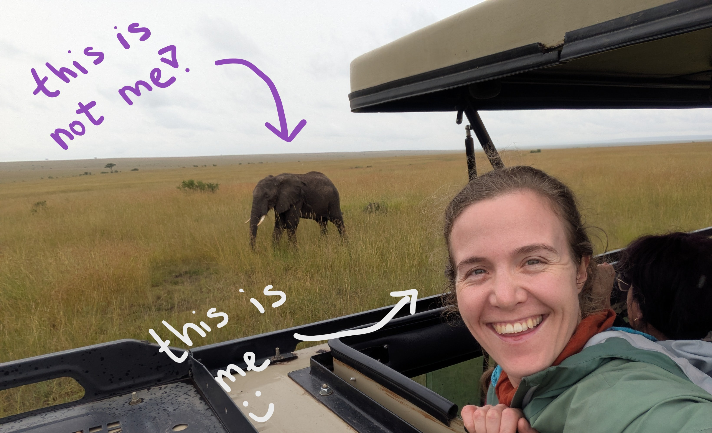

Projects with Jenni
===================================

Tips and tricks for BSc and MSc projects
with `Jenni Rinker <https://orbit.dtu.dk/en/persons/jennifer-marie-rinker>`_.
See table of contents below for more information.

|

.. note::

   The source code for these docs is `here on GitHub <https://github.com/jennirinker/projects-with-jenni/tree/main>`_.

Contents
--------

.. toctree::
   :maxdepth: 4

   define-start-project
   project-management
   think-like-a-researcher
   literature-survey
   writing-and-reports
   defense
   report-issues
